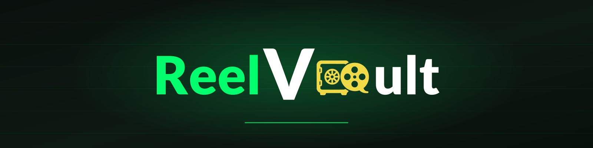

<div align="center">



# @reelvault/sdk

**Type-safe building blocks for ReelVault.**

[](https://www.npmjs.com/package/@reelvault/sdk)
[](https://github.com/ReelVault/sdk)
[](https://reelvault.org/sdk/)
[](LICENSE)

[Docs](https://reelvault.org/sdk/) · [What's inside](#whats-inside) · [Install](#install) · [Usage](#usage) · [Development](#development)

</div>

This is the typed TypeScript SDK for [ReelVault](https://github.com/ReelVault/reelvault), the self-hosted media server. The server and its clients use the same schemas, so the types you code against always match what the server sends back.

## What's inside

| | |
|---|---|
| 🌐 **A typed API client** | `ReelVaultClient` covers the whole API, with autocomplete as you type and responses you can trust. |
| 📐 **Shared contracts** | One set of schemas on both sides. Change a shape once and server and clients all see the same change. |
| 🧩 **Plugin building blocks** | `definePlugin`, the host API and manifest types have everything you need to add features inside the server. |
| 🎨 **A UI kit for plugins** | Put a page, dialog or tab in the admin panel with custom elements, or describe it with a schema the host renders for you. |
| 🧪 **An in-memory test host** | `PluginTestHost` lets you unit-test a plugin without starting a server. |
| 📦 **ESM and CommonJS** | Every entry point ships in both formats, with full TypeScript declarations. |

## Install

```bash
bun add @reelvault/sdk
# or
npm install @reelvault/sdk
```

Requires Bun 1.4.2 or newer, or Node.js 20 or newer.

## Entry points

| Import | What you get |
| --- | --- |
| `@reelvault/sdk` | Everything: client, contracts and errors |
| `@reelvault/sdk/client` | `ReelVaultClient` and its resource clients |
| `@reelvault/sdk/common` | Request and response schemas, with their types |
| `@reelvault/sdk/plugin` | `definePlugin`, `PluginHost` and the plugin contracts |
| `@reelvault/sdk/ui` | Plugin UI kit: custom elements and schema builders |
| `@reelvault/sdk/ui/schema` | Schema builders only (tree-shakeable) |
| `@reelvault/sdk/testing` | `PluginTestHost`, an in-memory host for unit tests |

## Usage

### API client

```ts
import { ReelVaultClient } from "@reelvault/sdk/client";

const api = new ReelVaultClient({ baseUrl: "http://localhost:3030" });

await api.auth.login({ email: "me@example.com", password: "…" });
const titles = await api.metadata.getAll({ limit: 20 });
```

### Shared types

```ts
import type { MovieDetail, RealtimeEventMap } from "@reelvault/sdk/common";
```

### Plugin

```ts
import { definePlugin } from "@reelvault/sdk/plugin";

export default definePlugin({
	async setup(host) {
		host.logger.info("plugin ready");
	},
});
```

A plugin lists the host features it uses in its `plugin.json` manifest. See the [plugin guide](https://reelvault.org/plugins/getting-started).

## Development

Everything here is for people working on the SDK itself.

### Commands

```bash
bun install
bun run check-types
bun test
bun run build        # writes dist/: ESM, CommonJS and .d.ts files
```

### Linking a local copy

To try a local SDK in your server or website checkout, link this package:

```bash
# in this directory
bun link

# in the consuming project
bun link @reelvault/sdk
```

### Releases

Pushing a `v*` tag publishes the package to npm through CI.

> **Note:** Plugins don't bundle this package. The server supplies its own copy at runtime and resolves `@reelvault/sdk/*` imports itself. Add the SDK as a `devDependency` — you only need it for types and builds.

## Documentation

- [SDK overview and API reference](https://reelvault.org/sdk/)
- [Plugin guide](https://reelvault.org/plugins/getting-started)

Contributions are welcome — see [CONTRIBUTING.md](https://github.com/ReelVault/.github/blob/main/CONTRIBUTING.md).

## License

GPL-3.0-only. See [LICENSE](LICENSE).
